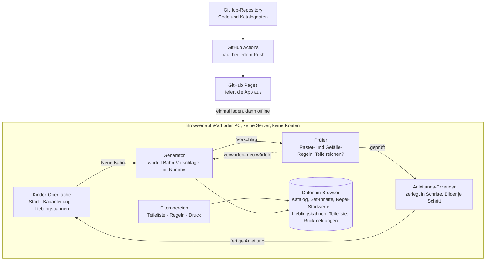
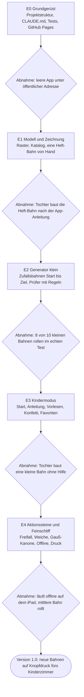

# GraviTrax Map Designer – Konzept

Stand: 19. November 2026 · Quelle ist das gemeinsam bearbeitete Konzept-Dokument; diese Datei ist der Stand bei Etappe E0.

## Ziel und Zielgruppe

Der GraviTrax Map Designer erfindet auf Knopfdruck neue Kugelbahnen aus dem Starter-Set deiner Tochter und zeigt sie Schritt für Schritt, wie eine Lego-Anleitung. Die Nutzerin ist sechs Jahre alt: große Bilder, ein Schritt pro Bildschirm, kein Text, den sie lesen muss.

Die App löst drei Probleme:

- **Immer neue Bahnen.** Das Heft im Set hat wenige Vorlagen. Die App erzeugt beliebig viele Bahnen, die genau mit den vorhandenen Teilen auskommen.
- **Selbstständig bauen.** Jeder Schritt zeigt wenige neue Teile farbig auf der Platte, dazu die Teile als Bilder mit Anzahl. Am Ende wird die Kugel getestet.
- **Wächst mit.** Drei Größen (klein, mittel, groß): von der kurzen Bahn mit Kurven bis zur Bahn mit Freifall und Gauß-Kanone.

Nutzerin ist deine Tochter. Du bekommst einen Elternbereich für Teileliste, Schwierigkeit und Druck. Die App läuft im Browser auf dem iPad, auch ohne Netz, ohne Konto und ohne Kosten.

## Funktionsumfang Version 1

Version 1 hat drei Teile: den Bahn-Generator, die Bauanleitung für das Kind und die Teileliste für die Eltern. Einen Editor zum Selberplanen gibt es nicht: Teile eingeben, Knopf drücken, Anleitung bekommen.

**Bahn-Generator**

- Erzeugt auf Knopfdruck eine neue Bahn, die nur Teile aus der Teileliste braucht und nach den Regeln aus dem Abschnitt „Regeln der Spielwelt“ baubar ist.
- Drei Größen: Klein ist ein kurzer Weg vom Start zum Ziel aus Kurven, Schienen und Höhen. Mittel hat dazu einen Aktionsstein (Freifall oder Weiche). Groß hat mehrere Aktionssteine, längere Wege und mehr Platten.
- Jede Bahn hat ein Vorschaubild und eine Nummer. Dieselbe Nummer ergibt immer dieselbe Bahn, so lässt sich jede Bahn merken und eine Panne nachstellen.
- Ein Prüfer kontrolliert jede Bahn: durchgehend bergab, Schienen gerade und passend, keine Teile im Weg, Teile reichen. Was durchfällt, sieht das Kind nie.

**Bauanleitung für das Kind**

- Ein Schritt pro Bildschirm: Draufsicht auf die Platte, neue Teile in Farbe, fertige Teile grau. Oben die Teile dieses Schritts als Bilder mit Anzahl, zum Beispiel zwei graue Steine und eine Kurve.
- Reihenfolge wie beim echten Bauen: Grundplatten legen, dann dem Kugelweg folgend vom Start zum Ziel je Feld den Höhenstapel und den Baustein setzen, dann die Schienen, zuletzt die Kugeln.
- Große Pfeile für Weiter und Zurück, Fortschrittspunkte, optional Vorlesen per Sprachausgabe.
- Letzter Schritt: „Kugel los!“ mit Konfetti und der Frage, ob die Kugel angekommen ist. Daumen hoch oder runter fließt in die Regeln zurück.
- Lieblingsbahnen: mit einem Herz merken und jederzeit wieder bauen.

**Teileliste für die Eltern**

- Vorbelegt mit dem Starter-Set (124 Teile, Tabelle im Abschnitt „Teile-Katalog und Teileliste“). Anzahl je Teil anpassbar, weitere Sets später zuschaltbar.
- Der Generator nutzt nur, was in der Liste steht.

**Nicht in Version 1**

- Kein Editor zum Selberplanen, auch später nicht. Die App entwirft, du und deine Tochter baut.
- Physik-Simulation. Stattdessen einfache Gefälle-Regeln und echte Testläufe mit deiner Tochter; was nicht rollt, wird als Regel nachgeschärft.
- Transparente Ebenen und Bahnen über mehrere Stockwerke.
- 3D-Ansicht, Konten, Cloud-Speicher, Teilen per Link.

## Bedienung

Zwei Bildschirme für das Kind, einer für die Eltern. Vom Start bis zum ersten Bauschritt sind es zwei Tipps. Alle Knöpfe sind groß, es gibt nur Tippen und Wischen, kein Zoomen und kein Tastaturfeld.

**Startbildschirm (Kind)**

- Drei große Karten: Kleine Bahn, Mittlere Bahn, Große Bahn, erkennbar an einer, zwei oder drei Kugeln als Symbol.
- Darunter die Lieblingsbahnen als Bilder.
- Tipp auf eine Karte: kurze Animation „Ich baue dir eine Bahn“, dann das Bild der fertigen Bahn mit Herz zum Merken und einem großen Pfeil „Los geht’s“.

**Bauanleitung (Kind)**

1. Mitte: die Platten von oben. Fertige Teile grau, die neuen Teile dieses Schritts farbig und leicht pulsierend. Die Höhe eines Feldes steht als kleiner Stapel daneben: so viele graue und schwarze Steine, wie nötig sind.
2. Oben: die Teile dieses Schritts als Bilder mit Zahl.
3. Unten: große Pfeile Zurück und Weiter, Fortschrittspunkte, Lautsprecher zum Vorlesen, Haus zurück zum Start.
4. Schritte sind klein: ein Feld mit Stapel und Baustein, oder eine Schiene, oder die Kugeln. Wischen nach links ist dasselbe wie Weiter.
5. Letzter Schritt: Kugeln in den Startstein, großer Knopf „Kugel los!“, Konfetti. Dann die Frage mit Daumen hoch und Daumen runter, ob die Kugel im Ziel war.
6. Jederzeit erreichbar: das Bild der ganzen fertigen Bahn zum Vergleichen.

**Elternbereich**

- Hinter einer Kindersperre (langes Drücken plus Rechenaufgabe).
- Teileliste mit Anzahl je Teil, Schwierigkeit feinjustieren, Gefälle-Regeln anpassen.
- Liste der Bahnen mit Daumen runter, um Regeln nachzuschärfen.
- Drucken einer Bahn als PDF, alle Schritte auf wenigen Seiten.

## Regeln der Spielwelt

Die App bildet das Stecksystem als Sechseck-Raster ab. Der Generator darf nur Bahnen vorschlagen, die die Rasterregeln erfüllen. Für die Physik nutzt er einfache Gefälle-Regeln mit Startwerten, die wir mit echten Testläufen nachschärfen.

**Rastermodell**

- Jedes Feld ist ein Sechseck mit sechs Nachbarn. Intern zählt die App in Axialkoordinaten (q, r), die übliche Mathematik für Sechseck-Raster.
- Die Grundplatte hat 27 Felder in sechs versetzten Reihen mit abwechselnd 4 und 5 Feldern, nachgezählt in der Zeichnung auf Seite 3. Die transparente Ebene hat 19 Felder in Sechseckform (3, 4, 5, 4, 3). Mehrere Platten liegen Kante an Kante und bilden ein durchgehendes Raster. Außerhalb einer Platte lässt sich nichts setzen.
- Jedes Feld trägt einen Höhenstapel aus großen und kleinen Höhensteinen und darauf höchstens einen Baustein. Die App rechnet daraus eine Höhenzahl.
- Ein Baustein hat einen Typ, eine Drehung in sechs Stufen und Ein- und Ausgänge in bestimmten Richtungen. Welche, steht im Teile-Katalog, nicht im Code.
- Eine Schiene verbindet zwei Bausteine, die auf einer geraden Rasterlinie liegen. Die kurze Schiene überbrückt ein freies Feld, die mittlere zwei, die lange drei. Felder unter einer Schiene tragen keinen Baustein.
- Eine Bahn ist eine Kette vom Startstein zum Ziel. Jeder Ausgang führt entweder direkt in den Nachbarbaustein oder über eine Schiene weiter.

**Gefälle-Regeln (Startwerte, werden mit Tests angepasst)**

| Regel | Startwert | Grund |
| --- | --- | --- |
| Start und Ziel | Startstein auf dem höchsten Stapel, Ziel unten auf der Platte | Die Kugel rollt nur bergab |
| Direkt benachbarte Bausteine | gleiche Höhe, Übergang ohne Schiene | So stecken die Teile zusammen |
| Schiene | Zielfeld mindestens einen großen Höhenstein tiefer, bei der langen Schiene zwei | Schwung über die Lücke |
| Bausteine auf gleicher Höhe hintereinander | höchstens drei, dann muss es bergab gehen | Kurven bremsen |
| Freifall | senkt den Weg um den ganzen Stapel darunter | Die Kugel fällt durch das Loch |
| Gauß-Kanone | danach darf es ein Stück eben weitergehen | Gibt der Kugel neuen Schwung |

Der Prüfer verwirft jede Bahn, die eine Raster- oder Gefälle-Regel verletzt, deren Weg nicht im Ziel endet oder deren Teile nicht reichen. Der Generator würfelt dann neu. Nur geprüfte Bahnen erreichen das Kind.

**Vor dem Programmieren am echten Material messen**

Für diese Werte habe ich keine verlässliche Quelle gefunden. Sie landen als Zahlen im Katalog und lassen sich jederzeit korrigieren, ohne Code anzufassen. Die Gefälle-Tests sind ein gutes Spiel für euch beide:

- [ ] Wie zwei Grundplatten aneinanderliegen: Kante an Kante oder versetzt. Die 27 Felder je Platte sind aus der Zeichnung gezählt, ein Blick aufs Original zur Sicherheit.
- [ ] Höhen: wie viele kleine Höhensteine so hoch sind wie ein großer.
- [ ] Gefälle-Test: Wie viele große Höhensteine Unterschied braucht eine kurze, eine mittlere und eine lange Schiene, damit die Kugel sicher ankommt? Wie viele Kurven hintereinander auf gleicher Höhe schafft sie?
- [ ] Je Baustein: wo die Kugel hinein- und wo sie hinausrollt. Ich liefere dafür eine vorausgefüllte Tabelle, du prüfst sie mit dem Teil in der Hand.
- [ ] Transparente Ebene: worauf sie aufliegt und wie hoch (19 Felder laut Zeichnung, für Version 1.1).

## Technik

Eine reine Browser-App ohne Server: TypeScript mit React, gebaut mit Vite, gezeichnet als SVG, kostenlos gehostet auf GitHub Pages. Neu gegenüber einem reinen Editor sind drei Bausteine ohne Oberfläche: Generator, Prüfer und Anleitungs-Erzeuger. Sie lassen sich tausendfach automatisch testen, bevor ein Kind sie sieht.



Der Generator würfelt Bahnen, der Prüfer verwirft alles, was nicht baubar ist, und erst eine geprüfte Bahn wird zur Schritt-für-Schritt-Anleitung. GitHub liefert die App einmal aus, danach läuft alles im Browser.

| Bereich | Wahl | Warum |
| --- | --- | --- |
| Sprache und Oberfläche | TypeScript, React | Verbreitet, gut testbar, später leicht von anderen weiterzuentwickeln |
| Build | Vite | Schneller Start, fertiges Plugin für Offline-Betrieb |
| Generator | Zufall mit Nummer (Seed), Regeln aus dem Katalog | Gleiche Nummer ergibt dieselbe Bahn, Pannen lassen sich nachstellen |
| Prüfer und Anleitungs-Erzeuger | Reine Funktionen ohne Oberfläche | Tests spielen tausende Bahnen durch, bevor ein Kind eine sieht |
| Darstellung | SVG | Scharf bei jedem Zoom, neue Teile direkt hervorhebbar |
| Vorlesen | Sprachausgabe des Browsers (Web Speech API) | Keine Server, deutsche Stimme ist auf dem iPad vorhanden |
| Speicher im Browser | IndexedDB | Lieblingsbahnen, Teileliste und Rückmeldungen überleben Neustarts |
| Offline | PWA mit Service Worker | Auf dem iPad zum Home-Bildschirm, läuft ohne Netz |
| Drucken | Druckdialog des Browsers, PDF | Alle Schritte auf wenigen Seiten, ohne Zusatzsoftware |
| Hosting | GitHub Pages über GitHub Actions | Kostenlos, veröffentlicht automatisch bei jedem Push auf main |
| Tests | Vitest (Raster, Regeln, Generator), Playwright (ein Klickpfad) | Jede Regeländerung wird gegen tausende generierte Bahnen geprüft |
| Datenschutz | Keine Konten, kein Tracking, keine Server | Nichts zu warten, nichts zu bezahlen |

**Dateiformat**

Eine Bahn ist eine JSON-Datei mit Versionsnummer, Nummer (Seed) und Größe. Zusätzlich stehen Felder, Schienen und Schritte darin, damit eine gemerkte Bahn auch nach Regeländerungen gleich bleibt. Gekürztes Beispiel:

```json
{
  "version": 1,
  "seed": 48213,
  "size": "klein",
  "plates": [{ "id": "p1", "x": 0, "y": 0 }],
  "cells": [
    { "q": 2, "r": -1, "large": 3, "small": 0, "tile": { "type": "start", "rot": 0 } },
    { "q": 2, "r": 1, "large": 2, "small": 0, "tile": { "type": "kurve", "rot": 3 } }
  ],
  "rails": [{ "from": [2, -1], "to": [2, 1] }],
  "steps": [{ "add": ["cell:2,-1"] }, { "add": ["cell:2,1"] }, { "add": ["rail:0"] }]
}
```

Der Teile-Katalog, die Set-Inhalte und die Gefälle-Regeln liegen als eigene JSON-Dateien im Repository. Ein neues Teil, ein neues Set oder ein neuer Startwert ist ein Eintrag dort, kein neuer Code.

## Teile-Katalog und Teileliste

Die Teileliste startet mit dem Starter-Set deiner Tochter: 124 Teile laut Anleitung. Die Anzahlen stammen aus deinem Foto von Seite 3. Die Namen sind mein Abgleich mit Händlerlisten für dieses Set; bei fünf Symbolen bin ich unsicher und habe sie beschrieben statt benannt.

| Teil | Anzahl | Symbol auf Seite 3 | Im Generator |
| --- | --- | --- | --- |
| Grundplatte | 4 | Zeile 1, rechts | Fläche für die Bahn, ab E1 |
| Transparente Ebene | 2 | Zeile 3, rechts | Version 1.1 |
| Großer Höhenstein, grau | 40 | Zeile 5 | Höhenstapel, ab E1 |
| Kleiner Höhenstein, schwarz | 12 | Zeile 5 | Feinhöhe, ab E1 |
| Kurve | 21 | Zeile 1, 1. Bild | Hauptbaustein, ab E2 |
| Schiene kurz | 9 | Zeile 4 | ab E2 |
| Schiene mittel | 6 | Zeile 3 | ab E2 |
| Schiene lang | 3 | Zeile 3 | ab E2 |
| Startstein | 1 | Zeile 2, 1. Bild | Start jeder Bahn, ab E2 |
| Zielleiter | 1 | Zeile 1, 4. Bild | Ziel jeder Bahn, ab E2 |
| Freifall (grün, mit Loch) | 1 | Zeile 1, 3. Bild | Mittel, E4 |
| Weiche (grüner Hebel), vermutlich | 2 | Zeile 2, 2. Bild | Mittel, E4 |
| Gauß-Kanone, vermutlich | 1 | Zeile 3, 2. Bild | Groß, E4 |
| Fänger (grüne Schale), vermutlich | 2 | Zeile 3, 3. Bild | Ziel-Alternative, E4 |
| Wirbel, vermutlich | 1 | Zeile 3, 1. Bild | später |
| Splash, vermutlich | 1 | Zeile 2, 3. Bild | später |
| Unklar: Sechseck-Mulde mit drei Öffnungen | 3 | Zeile 1, 2. Bild | nach Klärung |
| Unklar: drei Rinnen treffen sich | 3 | Zeile 4, 1. Bild | nach Klärung |
| Unklar: grüner Bogen | 1 | Zeile 4, 2. Bild | nach Klärung |
| Unklar: grünes Sechseck, glatt | 1 | Zeile 4, 3. Bild | nach Klärung |
| Unklar: Sechseck-Rand | 1 | Zeile 5, 1. Bild | nach Klärung |
| Kugeln | 6 | Zeile 2 | Testlauf |
| Hefte | 2 | Zeile 5 | keine |

Händlerlisten nennen für dieses Set außerdem 3 Kreuzungen, 1 Dreiwege-Stein (3-in-1) und 1 Zieleinsatz. Die fünf unklaren Zeilen sind vermutlich genau diese Teile; die Namen stehen auf der Verpackung oder im Heft.

**Katalog-Eintrag je Teil**

- Kennung, Name, Gruppe (Grundplatte, Höhe, Schiene, Baustein, Aktionsstein) und Bild für die Anleitung.
- Ein- und Ausgänge: in welchen der sechs Richtungen die Kugel hinein- und hinausrollt, bezogen auf Drehung 0.
- Wirkung auf den Weg: senkt (Freifall), gibt Schwung (Gauß-Kanone), wechselt (Weiche). Der Generator liest das als Daten.
- Ab welcher Größe der Generator das Teil einsetzt.

**Teileliste (Eltern)**

- Das Starter-Set ist vorbelegt, jede Anzahl lässt sich ändern, etwa bei verlorenen Teilen.
- Weitere Sets kommen später als Einträge im Katalog dazu und werden mit einem Haken aktiviert.
- Der Generator zieht nie mehr Teile als in der Liste stehen; die Anleitung zeigt je Schritt, wie viele Teile von welcher Sorte gebraucht werden.

## Etappen

Fünf Etappen, jede endet mit etwas, das deine Tochter oder du ausprobiert. Erst nach der Abnahme beginnt die nächste.



Jede Raute ist eine Abnahme durch dich. Erst danach beginnt die nächste Etappe.

1. **E0 Grundgerüst.** Projektstruktur, CLAUDE.md mit den Regeln aus diesem Konzept, dieses Konzept als Datei im Repository, Tests, GitHub-Pages-Veröffentlichung. Abnahme: eine leere App ist unter einer öffentlichen Adresse erreichbar.
2. **E1 Modell und Zeichnung.** Raster, Teile-Katalog mit dem Starter-Set, Zeichnung von Platten, Stapeln, Bausteinen und Schienen. Eine Bahn aus dem Heft wird von Hand eingetragen und in Schritte zerlegt. Abnahme: deine Tochter baut diese Bahn nach der App-Anleitung nach.
3. **E2 Generator klein.** Zufallsbahnen vom Start über Kurven, Schienen und Höhen zum Ziel, Prüfer mit Raster- und Gefälle-Regeln. Abnahme: von zehn kleinen Bahnen rollen mindestens acht beim echten Test, danach werden die Regeln nachgeschärft.
4. **E3 Kindermodus.** Startbildschirm, Anleitung mit Hervorhebung, Vorlesen, Konfetti, Lieblingsbahnen, Daumen-Rückmeldung. Abnahme: deine Tochter baut eine kleine Bahn ohne Hilfe.
5. **E4 Aktionssteine und Feinschliff.** Freifall, Weiche, Gauß-Kanone, Größen Mittel und Groß, Elternbereich, Offline-Betrieb, Druck. Abnahme: läuft auf dem iPad ohne Netz und eine mittlere Bahn rollt. Das ist Version 1.0.

Danach, als Version 1.1 und später: transparente Ebenen, weitere Sets, Kreuzung, Splash und Wirbel, Teilen per Link, und als Experiment eine einfache Kugel-Simulation.

## Offene Fragen und nächste Schritte

Sechs Punkte liegen bei dir. Keiner blockiert E0, die ersten beiden brauche ich vor E2.

- [ ] **Teilenamen prüfen.** Die Tabelle im Abschnitt „Teile-Katalog und Teileliste“ hat fünf unklare Symbole. Am einfachsten: die Teile mit deiner Tochter auf die Anleitungsseite legen und mir die Namen von der Verpackung oder aus dem Heft schicken.
- [ ] **Messwerte und Gefälle-Tests** aus dem Abschnitt „Regeln der Spielwelt“. Schienen und Felder je Platte sind geklärt. Offen: Höhenverhältnis, Gefälle-Tests und die Anschlüsse je Baustein. Zahlen oder Fotos reichen.
- [ ] **Lesen und Vorlesen.** Kann deine Tochter schon lesen? Vorschlag: keine Pflichttexte, Vorlesen zuschaltbar.
- [ ] **Welche Aktionssteine zuerst.** Vorschlag: Freifall, Weiche und Gauß-Kanone in E4; Kreuzung, Splash und Wirbel später.
- [ ] **Repository öffentlich stellen.** Entschieden: öffentlich. Das Repository ist derzeit noch privat. Die Umstellung geht nur in den GitHub-Einstellungen des Repositorys: Settings, General, ganz unten Danger Zone, Change repository visibility, Public.
- [ ] **Name.** GraviTrax ist eine Marke von Ravensburger. Für den Hausgebrauch unkritisch. Soll die App veröffentlicht werden, sollte ihr Name nicht mit „GraviTrax“ beginnen und keine Logos nutzen. Kann bis E4 warten.

**Nach deiner Freigabe**

1. Du gibst das Konzept frei, als Kommentar hier oder kurz im Chat, und beantwortest die Fragen, soweit schon möglich.
2. Ich fordere Schreibzugriff auf das Repository an und baue E0: Projektstruktur, CLAUDE.md, dieses Konzept als docs/konzept.md, Tests, GitHub-Pages-Workflow.
3. Nach jeder Etappe bekommst du eine kurze Zusammenfassung und höchstens fünf Prüfschritte.
